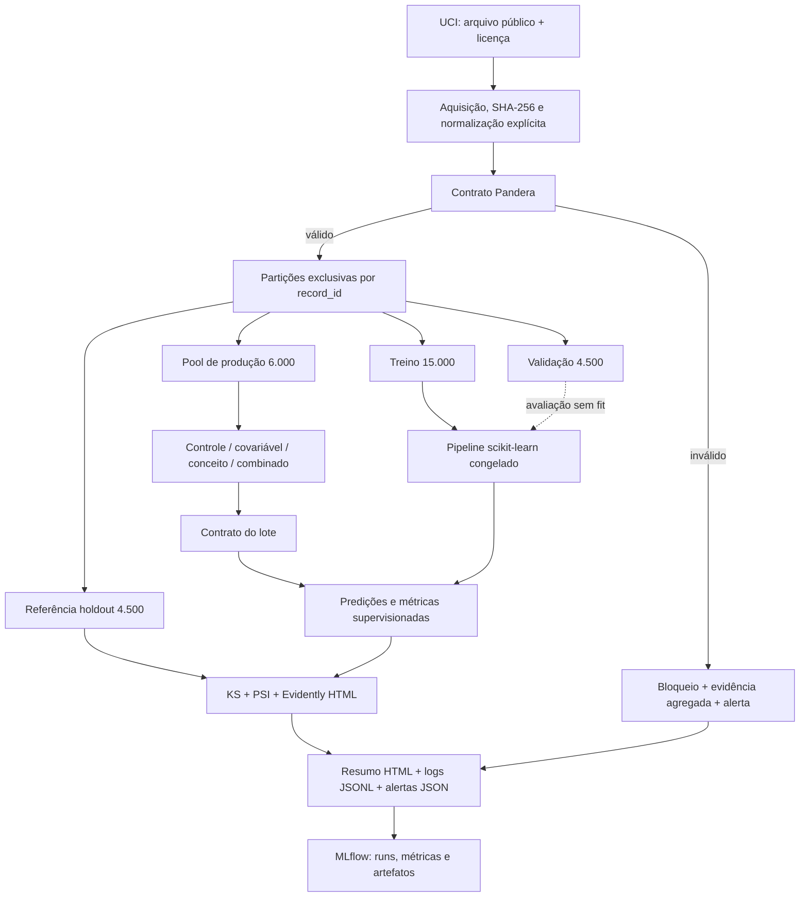

# Arquitetura da observabilidade de crédito

Este documento define a implementação do Tech Challenge Fase 4. As decisões abaixo são especificações, alinhadas às interfaces implementadas; os resultados medidos ficam no README, no [progresso](progresso.md) e nos artefatos identificados da execução. O projeto demonstra sustentação de um classificador financeiro, com contratos de dados, monitoramento e resposta operacional.

## Objetivo e escopo

O fluxo deve bloquear dados inválidos antes da inferência, distinguir mudança de distribuição de degradação supervisionada, centralizar evidências e explicar limites de privacidade e causalidade. A entrega usa Python 3.11, `uv` com `uv.lock`, layout `src/credito_monitorado`, Pandera, scikit-learn, Evidently e MLflow. Os parâmetros ficam em `params.yaml` na raiz; configuração de ambiente fica em `.env.example`, sem segredos.

O pipeline de crédito é executado localmente, sem exigir conta externa. As versões das dependências ficam congeladas em `uv.lock`.

## Blocos e fluxo

O modelo permanece congelado durante os cenários. Detectar drift gera alerta e investigação; o fluxo não retreina nem promove modelos automaticamente. A ordenação dos cenários representa tempo simulado, sem afirmar que a base contém coortes futuras observadas.

## Dados, proveniência e separação

A base escolhida é **Default of Credit Card Clients**, da UCI, com 30.000 registros, classificação binária de inadimplência, dados de Taiwan e histórico financeiro de 2005. A licença informada é CC BY 4.0; a atribuição deve acompanhar o projeto. Há limite de crédito, idade e histórico de pagamentos, mas não uma coluna de renda. O arquivo original inclui identificador e alvo. [Fonte oficial e licença](https://archive.ics.uci.edu/dataset/350/default+of+credit+card+clients).

O download oficial deve ser armazenado localmente, com URL, data UTC, tamanho, SHA-256, licença e contagem de linhas no manifesto. Um cache válido permite repetição sem rede. Mudança do hash esperado exige revisão explícita da proveniência; não deve ser aceita silenciosamente. Arquivo bruto, base completa, artefatos de modelo, banco MLflow e caches ficam fora do Git. Relatórios agregados e manifestos de evidência podem ser versionados após inspeção.

Após leitura do cabeçalho correto do XLS, normalizar nomes para `record_id`, `limit_bal`, `age`, `pay_0`, `pay_2` até `pay_6`, `bill_amt1` até `bill_amt6`, `pay_amt1` até `pay_amt6`, `sex`, `education`, `marriage` e `target`. A normalização não altera valores financeiros. Códigos categóricos presentes no arquivo, mas incompletamente descritos no catálogo, ficam documentados como códigos observados; não recebem significado inventado nem são convertidos em nulos.

| Partição | Fração | Linhas esperadas | Uso permitido |
|---|---:|---:|---|
| `train` | 50% | 15.000 | Ajustar transformações e classificador |
| `validation` | 15% | 4.500 | Avaliar escolhas do baseline com limiar predefinido |
| `reference` | 15% | 4.500 | Referência independente e avaliação congelada |
| `production_pool` | 20% | 6.000 | Gerar os cenários monitorados |

O split é estratificado por `target`, determinístico com seed 42 e sem sobreposição de `record_id`; as quatro contagens devem somar 30.000. O manifesto registra hashes ordenados dos IDs e das tabelas, proporções de classe e seed. Nenhum estimador aprende de `reference` ou `production_pool`. O enunciado associa referência à distribuição usada no treino; aqui o holdout representa essa distribuição sem reutilizar as mesmas observações, o que evita comparação otimista. A validação também não entra no `fit` final.

Cada cenário contém 2.500 registros únicos do pool. Cenários contrafactuais podem compartilhar IDs entre si, com vínculo no manifesto. Essa sobreposição é deliberada para comparação pareada, não autoriza sobreposição entre treino, validação, referência e pool, nem duplicatas dentro de um lote.

## Contrato e bloqueio

O Pandera valida estrutura, tipos, finitude e regras antes do treino e antes de cada inferência. O schema usa validação lazy internamente e rejeita o lote inteiro; a exceção pública é genérica e não preserva valores individuais nem o contexto do erro Pandera. As contagens por regra da demonstração descrevem as anomalias injetadas, não um diagnóstico detalhado de qualquer lote externo. Não completar nulos, remover linhas, truncar valores ou converter uma falha em sucesso silenciosamente. O uso de schemas e validação explícita segue a [documentação do Pandera](https://pandera.readthedocs.io/en/stable/dataframe_schemas.html).

| Regra rígida | Decisão |
|---|---|
| Schema | Colunas obrigatórias presentes, tipos numéricos corretos e sem colunas desconhecidas no contrato de entrada |
| Nulos e infinitos | Nenhum valor ausente ou infinito nas colunas exigidas |
| Identidade | `record_id` inteiro positivo, único dentro do lote |
| Idade | `19 <= age <= 100`, inteira, em anos |
| Crédito | `0 < limit_bal <= 2.000.000`, em NT$, sem tratar limite como renda |
| Pagamentos | `0 <= pay_amt1..6 <= 2.000.000`; estados `pay_*` inteiros entre -2 e 8 |
| Faturas | `-1.000.000 <= bill_amt1..6 <= 2.000.000`, finitas |
| Demografia e alvo | `sex` em {1,2}; `education` em {0,1,2,3,4,5,6}; `marriage` em {0,1,2,3}; `target` em {0,1} quando rótulos forem exigidos |

Os domínios são política acadêmica para o arquivo fixado, não limites universais do crédito ou de todos os códigos do catálogo. Saldos `bill_amt*` negativos são permitidos: um saldo negativo não deve ser confundido com pagamento inválido. O contrato de inferência permite ausência do alvo e de `sex`, `education` e `marriage`; quando presentes, essas colunas são validadas. As métricas supervisionadas sem alvo ficam pendentes; alvo presente com nulos viola o contrato. Treino e auditoria exigem as colunas completas. A demonstração injeta nulo, idade inválida e ID duplicado em um lote reservado. O bloqueio esperado deve gerar status próprio, sem chamar o modelo. Uma demonstração de rejeição bem-sucedida não torna toda a execução uma falha operacional.

## Modelo e métricas

O baseline é uma `Pipeline` scikit-learn com seleção explícita de atributos financeiros e idade e `HistGradientBoostingClassifier` ajustado somente em treino. Usar `max_iter=150`, `learning_rate=0.08` e `max_leaf_nodes=15`, conforme `params.yaml`; esse estimador dispensa padronização dos atributos. `record_id`, `sex`, `education`, `marriage` e `target` não entram como preditores. Os atributos demográficos são mantidos apenas na base local para auditoria agregada. A referência da prevenção de vazamento é a [documentação de boas práticas do scikit-learn](https://scikit-learn.org/stable/common_pitfalls.html).

Treino registra seed, hiperparâmetros, lista e ordem dos atributos, versões, hashes das partições, limiar e métricas. O limiar é predefinido em 0,30 na configuração e permanece congelado nos cenários. Comparar com `DummyClassifier(strategy="prior")`. Exigir AUROC da validação acima de 0,65 e acima do baseline trivial; não escolher parâmetros após observar produção.

Publicar AUROC, average precision, F1, precisão, recall e Brier; nos cenários, incluir matriz de confusão, prevalência de inadimplência e número de rótulos. Métricas indefinidas recebem estado explícito, não zero inventado. `modelo.joblib` persiste um bundle com `pipeline`, `features` e `threshold`; o roundtrip verifica probabilidades e decisões após carregar esse bundle confiável. A função interna `predict` recebe a pipeline e o limiar extraídos do bundle.

## Experimentos de drift

Os quatro cenários são contrafactuais sintéticos. Seeds, seleção, alterações e contagens ficam no manifesto. Nomes de cenários e metadados das intervenções não entram como atributos do modelo nem como prova automática no detector; `limit_bal` e `pay_0` são atributos financeiros efetivamente monitorados.

| Cenário | Construção | Evidência esperada |
|---|---|---|
| `control` | Amostra uniforme sem reposição de 2.500 linhas do pool | Ausência de mudança material nas duas variáveis provocadas; desempenho de referência contextualiza a variação amostral |
| `covariate` | Amostra ponderada sem reposição; peso multiplicado por 3 quando `limit_bal` é menor/igual à mediana da referência e por 4 quando `pay_0 >= 1` | Drift material em `limit_bal` e `pay_0`, com IDs únicos e rótulos originais |
| `concept` | Copiar controle, preservar todos os X e IDs; inverter `target` com probabilidade 0,8 apenas no grupo `pay_0 <= 0` | Predições idênticas ao controle e piora supervisionada, sem novo drift de X |
| `combined` | Aplicar o mecanismo de conceito ao lote covariável | Drift em X e degradação supervisionada simultâneos |

A seleção covariável usa somente X e não altera o mecanismo dos rótulos originais. Sob a hipótese de seleção condicionada exclusivamente a X, ela muda `P(X)` e preserva o mecanismo `P(Y|X)`. A base finita não comprova independência nem permite estimar perfeitamente essa condicional; por isso a execução documenta a hipótese e suas limitações. Transformar X mantendo y seria outro experimento, com possível alteração simultânea da relação condicional, e não substitui esta demonstração.

O cenário de conceito mantém o mesmo X do controle e altera deliberadamente a relação com y. O hash dos atributos e as probabilidades previstas devem ser idênticos entre esses dois lotes; o combinado é pareado ao covariável. A atribuição da inversão usa SHA-256 de seed/ID, de modo que um registro compartilhado receba a mesma intervenção entre cenários. A inversão simula uma mudança na relação entre perfil e inadimplência; não representa inadimplência futura medida, correção de erro real ou efeito causal da economia.

### Detecção estatística

Comparar sempre com a referência congelada e comparar conceito também com seu controle pareado. Configurar explicitamente métodos e limiares no adapter Evidently; não depender de seleção automática ou de um campo genérico cujo significado possa ser p-valor ou distância. O HTML inclui distribuições, nomes das colunas, métodos, scores e decisões. [Referência de métricas do Evidently](https://docs.evidentlyai.com/metrics/all_metrics).

- Contínuas, inclusive `limit_bal`: KS de duas amostras, p-valor corrigido por Benjamini-Hochberg a 5% na família de atributos contínuos e tamanho de efeito `D >= 0,10` para alerta material.
- Estados de pagamento, inclusive `pay_0`: PSI categórico no suporte compartilhado da união das categorias observadas, dentro do domínio do contrato; suavização das proporções com `epsilon=1e-6`, renormalização e alerta com `PSI >= 0,20`.
- PSI contínuo complementar: dez intervalos por quantis da referência, bordas extremas abertas para capturar valores fora do suporte, bordas repetidas removidas e distribuição constante tratada explicitamente. Não recalcular bins em produção.
- Conceito: Brier de `concept` menos Brier de `control` maior/igual a 0,05, com intervalo de confiança de 95% por bootstrap pareado (500 reamostragens, seed registrada) cuja borda inferior seja maior que zero. Reportar também diferença de AUROC, seu limiar complementar de queda de 0,05 e prevalência, sem inferir conceito só por uma mudança marginal de y.

Os limiares são critérios de demonstração definidos antes da avaliação, não limites universais do setor financeiro. Comparações com menos de 200 linhas válidas recebem status de amostra insuficiente. Drift de X não prova piora do modelo. Piora de desempenho com rótulos observados aciona investigação; em produção real, sozinha, também não prova uma causa específica. Sem rótulos, o estado de conceito é `pending_labels`, com cobertura de rótulos e atraso explicitados. O cenário sintético não deve ser confundido com esse atraso real.

A política própria é a autoridade dos alertas. O Evidently 0.7 produz evidência complementar com KS bruto por coluna, PSI e agregação próprios; ele não replica BH nem o corte de efeito da política. A diferença deve aparecer no HTML e nos metadados, sem apresentar as duas decisões como matematicamente idênticas. A família BH inclui apenas atributos contínuos de X, sem IDs, alvo ou demográficos excluídos. As comparações repetidas e a dependência entre atributos impedem interpretar o alpha como taxa operacional garantida de falsos alarmes.

## Observabilidade e resposta

O fluxo deve gerar `artifacts/<execution_id>/`: manifesto, métricas, evidência de contratos, logs JSONL, alertas JSON, relatórios Evidently por cenário e um HTML consolidado. Toda evidência compartilha `execution_id`, `scenario`, hash da configuração e identificação do modelo. Falhas inesperadas produzem status de falha e código de saída não zero. A execução só declara sucesso após verificar os artefatos esperados.

| Sinal | Unidade / definição | Ação |
|---|---|---|
| Estado do estágio | `sucesso`/`falha`, com `expected_failure`; contrato demonstrativo `blocked_as_expected` | Falha inesperada interrompe dependentes; bloqueio de lote impede inferência |
| Volume | Linhas recebidas, válidas, rejeitadas, com rótulo | Investigar quebra de volume/cobertura |
| Latência | Duração do estágio em segundos; inferência também por lote | Alertar acima de 120 segundos por estágio |
| Recursos | RSS em MiB, CPU acumulada em segundos, disco livre em GiB | Alertar RSS acima de 2.048 MiB ou disco abaixo de 1 GiB; amostras nos limites dos estágios |
| Qualidade | Quantidade de regras e linhas rejeitadas, por motivo | Corrigir origem e revalidar |
| Drift | KS D/p ajustado, PSI, quantidade e fração de atributos em alerta | Investigar distribuição e cadeia de coleta |
| Modelo | Métricas supervisionadas, prevalência e cobertura de rótulos | Revisão humana; comparar controle e estabilidade |
| Alertas | Severidade, regra, valor, limiar e ação sugerida | Registrar triagem e decisão |

O MLflow registra execução e cenários em runs relacionados, parâmetros, métricas, tempos e artefatos, usando SQLite e diretório de artefatos locais. A UI facilita comparação e auditoria; o HTML consolidado permite avaliação sem abrir o servidor. Uma falha de tracking não pode ser ocultada como rastreamento concluído. A documentação deve registrar o modo disponível e o erro. O escopo de tracking segue a [documentação do MLflow](https://mlflow.org/docs/latest/ml/tracking/).

`telemetry.py` centraliza eventos, alertas e recursos; `tracking.py` integra MLflow e sincroniza os artefatos finais. `fairness.py` calcula taxas descritivas por sexo/faixa etária na referência independente, com supressão abaixo de 30 registros. As taxas não demonstram justiça nem causalidade, e os recortes exigem inspeção antes da divulgação. Idade permanece preditora, uma escolha acadêmica que precisa ser reavaliada para concessão real.

Logs não incluem linhas individuais, identificadores de clientes, valores sensíveis, tokens nem stack traces com dados de entrada. A análise causal registra: intervenção conhecida na simulação, efeito observado, hipóteses alternativas no mundo real, verificações propostas e decisão operacional. Exemplos de alternativas são mudança de seleção de clientes, política de concessão, erro de coleta e atraso de rótulos. Um alerta não determina automaticamente suspensão total do crédito: a decisão cabe ao responsável de risco.

## Privacidade, governança e LGPD

O uso acadêmico de uma base pública não autoriza inferir que toda combinação de atributos é anônima ou aplicar o modelo no Brasil. O projeto não concede crédito real, não tenta reidentificação e usa apenas os campos necessários. Para uma fintech, proteção do crédito pode ser base aplicável (art. 7º, X); o controlador deve justificar finalidade, necessidade e enquadramento, com revisão jurídica do caso. Há direitos do titular e revisão de decisões automatizadas (arts. 18 e 20). [LGPD, texto atualizado da Câmara](https://www2.camara.leg.br/legin/fed/lei/2018/lei-13709-14-agosto-2018-787077-normaatualizada-pl.html).

O plano operacional atribui ao executor local a reprodução e inspeção dos artefatos. Em uma fintech, designar responsáveis por integridade dos dados, risco, segurança e atendimento; não inventar integrantes ou contatos institucionais. Aplicar acesso local mínimo, segredos fora do repositório, backups controlados e relatórios agregados. Suprimir grupos de auditoria com menos de 30 pessoas; publicar contagem e diferenças de taxas/métricas por sexo e faixa etária quando houver amostra suficiente, observando necessidade de supressão complementar. Excluir atributos do modelo não garante ausência de viés por proxies. Revisão por pessoa habilitada é política recomendada, sem atribuir ao art. 20 uma obrigação geral de revisão humana.

Como política acadêmica proposta, reter dados e artefatos locais até 90 dias após avaliação, eliminar caches e backups no mesmo ciclo e preservar apenas código e resultados agregados inspecionados. Esse prazo não é prazo legal obrigatório. Em uma fintech, a tabela de retenção deve distinguir finalidade, obrigação regulatória e exceções à eliminação (arts. 15 e 16), com registro da justificativa. O README deve conter inventário, retenção, canal de direitos, revisão humana, riscos de reidentificação, resposta a incidentes e limites de generalização. [Término e conservação na LGPD](https://normas.leg.br/?urn=urn%3Alex%3Abr%3Afederal%3Alei%3A2018-08-14%3B13709%402022-06-13%21art16).

## Critérios verificáveis e matriz de requisitos

| ID / critério do enunciado | Evidência exigida | Verificação de aceite |
|---|---|---|
| R01 — base financeira >= 5.000 | Manifesto e dicionário | 30.000 registros originais, fonte/licença/hash preenchidos |
| R02 — modelo baseline | Pipeline persistida e métricas | AUROC de validação > 0,65 e > Dummy; carregar e prever novamente |
| R03 — separação de dados | Manifesto de partições e teste | IDs mutuamente exclusivos, contagens 15k/4,5k/4,5k/6k, nenhum fit fora de treino |
| R04 — contratos (25%) | Pandera e evidência de lote inválido | Nulo, idade e duplicata rejeitados antes da inferência |
| R05 — drift em >= 2 variáveis (25%) | HTML Evidently e resumo estatístico | `limit_bal` com KS material e `pay_0` com PSI >= 0,20 no covariável |
| R06 — conceito e causalidade | Contrafactual, hashes e comparação pareada | X/probabilidades idênticos controle/conceito, piora de Brier com IC positivo e limites causais explícitos |
| R07 — observabilidade (20%) | HTML consolidado, logs e runs MLflow | Sucesso, bloqueio esperado, duração, volumes, recursos e alertas visíveis |
| R08 — governança (15%) | README e model/dataset cards | Finalidade, minimização, base legal contextualizada, retenção, direitos, vieses e resposta descritos |
| R09 — reprodução e histórico | uv.lock, CI, comandos e commits semânticos | Clone limpo executa verificação; evidências identificam configuração/modelo/dados |
| R10 — vídeo STAR (15%) | Roteiro demonstrativo textual | Somente roteiro <= 5 minutos; gravação e link excluídos do escopo autorizado |

O enunciado original exige vídeo e link. A execução autorizada nesta sessão entrega o roteiro e não grava vídeo; essa diferença deve ficar explícita no README, sem declarar cumprimento integral desse critério.

## Riscos e decisões de execução

| Risco | Mitigação e sinal de verificação |
|---|---|
| Download indisponível ou XLS interpretado errado | Cache com hash, leitura do cabeçalho correto, 30.000 IDs e schema obrigatório |
| API das bibliotecas mudou | Lock próprio, adapter Evidently, smoke real de HTML e SQLite MLflow |
| Drift deliberado insuficiente | Seeds e pesos fixos; medir as duas colunas e corrigir configuração com justificativa, sem usar y na seleção |
| Confundir drift com qualidade ou conceito | Cenários separados, contrato comum e teste X idêntico no conceito |
| Efeito pequeno com p-valor significativo | Exigir tamanho de efeito e publicar estatística completa |
| Vazamento ou repetição indevida | Manifesto de IDs, fit somente em treino e teste de exclusão de colunas |
| Evidência desatualizada | Cada execução grava diretório próprio e hashes; índice aponta execução concluída |
| Alegação de conformidade/causalidade excessiva | Limites no README; experimento sintético identificado; plano contextualizado |

Esforços solicitados: arquitetura e auditoria **xhigh**; pipelines e modelo **high**; estatística **high**; testes e refatorações **medium**; debugging **xhigh**. Velocidade **standard**, sem modo fast. Esses são parâmetros desejados do trabalho, não evidência de que um runtime sem controle explícito os aplicou. A revisão adversarial externa deve solicitar literalmente o modelo `fable`, registrar o identificador resolvido `claude-fable-5-2`, achados e correções, sem enviar dados individuais ou segredos.
