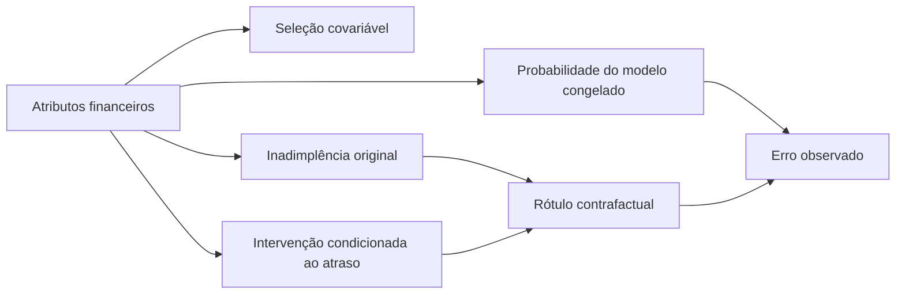

# Causalidade e limites da simulação

## Mecanismo conhecido

Há quatro cenários derivados exclusivamente do pool de produção, com 2.500 registros únicos por lote. O tempo é uma sequência simulada de cenários, não coortes futuras observadas.

| Cenário | Intervenção | O que permite observar |
|---|---|---|
| Controle | Amostra uniforme sem reposição | Linha de comparação não usada no treino. |
| Covariável | Seleção sem reposição por X: peso 3 se limite ≤ mediana da referência, multiplicado por 4 se `pay_0 >= 1` | Mudança da composição; rótulos preservados e seleção sem consultar y. |
| Conceito | Mesmo X, IDs, ordem e probabilidades do controle; inversão de y com probabilidade 0,8 somente quando `pay_0 <= 0` | Alteração condicional sintética de P(y\|X), com entradas invariáveis. |
| Combinado | Mesmo X do covariável e mesma regra condicional de inversão | Efeitos simultâneos; comparação de conceito é com o covariável. |

A inversão por SHA-256 de seed/ID é estável: o mesmo registro recebe a mesma intervenção entre os cenários de conceito/combinado. A seed não muda conforme os resultados. O modelo não é ajustado novamente.

O diagrama descreve a construção experimental. Não estima o efeito causal de inflação, desemprego ou renda; tais variáveis não estão observadas na base utilizada.

## Evidência e interpretação

O relatório testa distribuições de entrada com PSI/KS. No conceito, exige X e probabilidades idênticas e calcula a média da diferença pareada dos erros quadráticos. O bootstrap reamostra **pares de registros**, preservando a correspondência; o aumento material de Brier e IC95% positivo evidencia degradação sob a intervenção conhecida. O combinado usa `combined − covariate`, não `combined − control`.

Na população ideal, seleção dependente apenas de X preserva P(y\|X). Na base finita, métricas supervisionadas e prevalência podem mudar por composição; seleção ponderada sem reposição também limita o deslocamento possível. Isso não comprova invariância condicional empírica nem calibra uma taxa de falso alarme. O resultado real é publicado em [resultados](resultados.md).

O cenário de inversão é severo e serve à verificação de sanidade. Não foi feita curva dose–resposta, repetição de controles para estimar taxa de falsos positivos ou identificação de drift sutil. Scores de PSI/KS, classes raras, suavização e dependência entre features impõem cautela. Evidently bruto e política BH/efeito têm decisões distintas explicitadas nos relatórios.

## Investigação em uma fintech real

Antes de atribuir uma causa, verificar: mudanças de ETL/unidades/códigos; alteração da política de aprovação e canais; composição e sazonalidade; rotulagem incorreta, atrasada ou seletiva; mudança econômica e comportamento de pagamento. Comparar safras maduras, segmentos comparáveis, controles negativos e métricas por grupo; checar qualidade e cobertura dos rótulos.

Para inferir efeito econômico, seria necessário um desenho identificável, covariáveis relevantes, hipóteses justificadas e validação de confundimento/seleção. A carteira aprovada pode esconder rótulos dos rejeitados. Correlação temporal ou feature drift isolado não resolve esse viés. Encaminhar conclusões a risco/negócio, avaliar custos e equidade e validar eventual candidato antes de alterar decisões.
